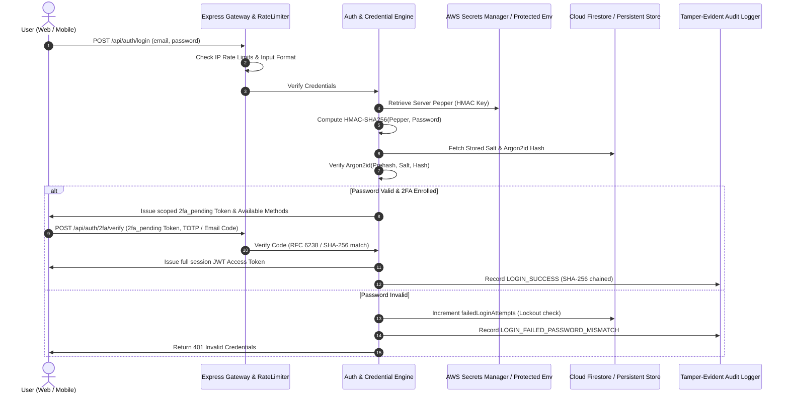
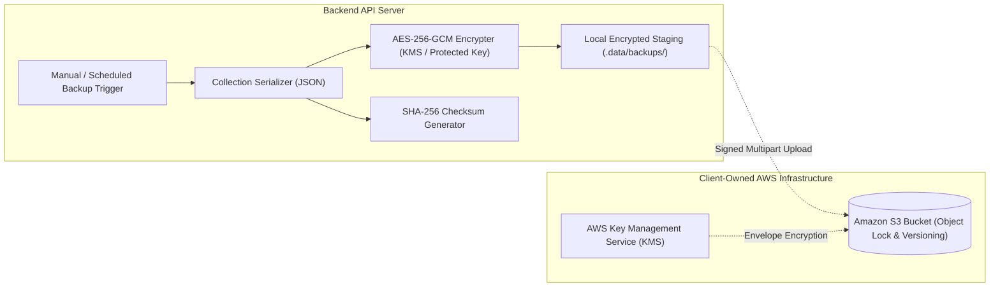

# Nina International: System Architecture & Engineering Design

## 1. Monorepo Structural Architecture

Nina International is organized as a clean, modular monorepo:

```
Nina International/
├── backend/                   # Node.js + Express + TypeScript Backend API
│   ├── src/
│   │   ├── config/            # Environment, Constants, Argon2 parameters
│   │   ├── services/          # Credential, TwoFactor, Token, School, Backup, Audit, ConfigSnapshot
│   │   ├── middleware/        # Auth, RBAC, RateLimiter, Validation
│   │   ├── controllers/       # Auth, CredentialAudit, User, School, Security, Backup
│   │   ├── routes/            # REST API endpoints
│   │   ├── seed/              # Initial database seeder (4 roles, classes, grades)
│   │   └── index.ts           # Server entry point & security headers
│   ├── test/                  # Automated security & cryptography test suite
│   ├── .data/                 # Local persistent JSON database store & backup staging
│   └── package.json
│
├── frontend/                  # Responsive Web Client (React 19 + TypeScript + Vite)
│   ├── src/
│   │   ├── api/               # API client with Bearer token authentication
│   │   ├── context/           # AuthContext (session, login, 2FA, logout)
│   │   ├── components/        # Navbar, AuthView
│   │   │   ├── admin/         # CredentialAudit, SecurityCentre, ConfigRestore, Backups, Users
│   │   │   ├── teacher/       # Classroom & Attendance, Grade Matrix with reason
│   │   │   ├── staff/         # Student Enrolment & Roster
│   │   │   └── student/       # Student ID Card, Grades, Timetable, 2FA setup
│   │   ├── App.tsx            # Main role-based navigation layout
│   │   └── main.tsx           # Web entry point
│   └── package.json
│
├── mobile/                    # Android Expo Go Mobile Client (React Native + TypeScript)
│   ├── src/
│   │   ├── config/            # API Base URL configuration manager
│   │   ├── services/          # SecureStore token storage & API service
│   │   └── screens/           # Login, 2FA, Admin, Teacher, Staff, Student screens
│   ├── App.tsx                # Mobile root navigation
│   └── package.json
│
├── shared/                    # Shared TypeScript interfaces and domain models
│   └── types.ts
│
├── firestore.rules            # Production Firestore Security Rules (Deny-by-default, 4-role RBAC)
└── docs/                      # Architectural, Security, Testing, and Deployment guides
```

---

## 2. Component Interaction & Data Flow



---

## 3. Disaster Recovery & AWS S3 Architecture



1. **Trigger**: An authorized administrator triggers a backup through the REST API or scheduled background job.
2. **Export**: Relevant database collections (user profiles, students, classes, attendance, grades, and audit history) are exported into a structured JSON payload.
3. **Integrity Checksum**: A SHA-256 digest is generated from the raw JSON payload.
4. **Authenticated Encryption**: The payload is encrypted using AES-256-GCM.
5. **Staging**: The encrypted binary artifact is written to staging.
6. **AWS S3 Transfer**: When client AWS credentials are provided, the archive is uploaded to the client-owned Amazon S3 bucket with KMS encryption.
7. **Verification**: The administrator can run an integrity test that reads the archive, decrypts it, verifies the SHA-256 hash, and checks document structure without modifying live school data.
